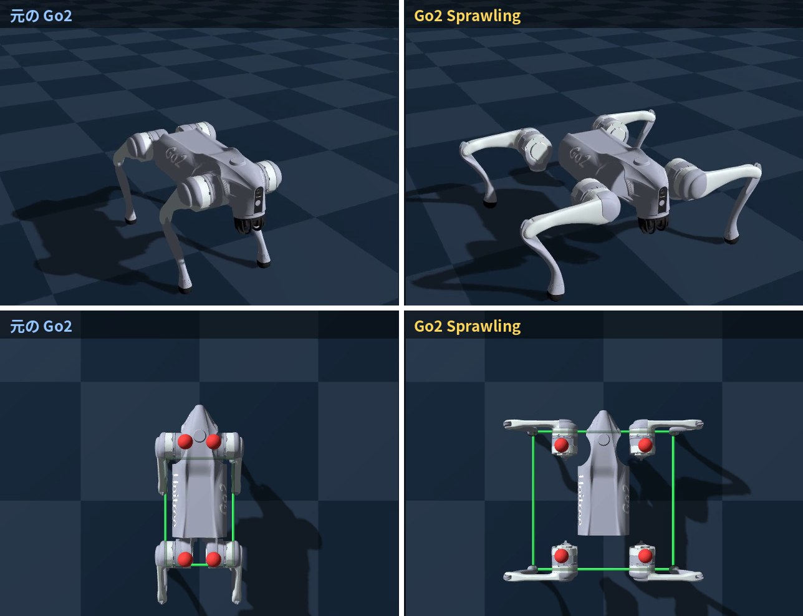
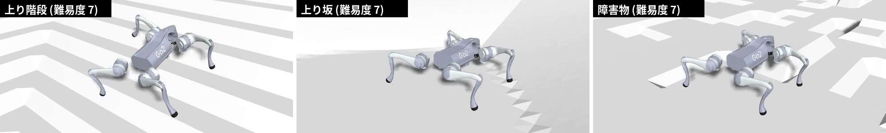
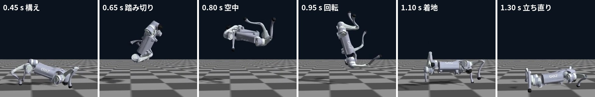

# Physical AI講座 2026 応用編1 最終課題

**Go2 Sprawling: 側方型脚構造を持つ改造 Unitree Go2 の強化学習**

## 概要

４脚歩行ロボットが低コストで入手できるようになって久しい。
しかし一般に流通しているのはMIT Cheetahなどを参考にした哺乳類に多く見られる直立型の脚構造を持つロボットである。
筆者は大学院時代、これらとは異なり爬虫類のような側方型（Sprawling)４脚歩行ロボットの研究をしており４脚歩行ロボット市場の現状に一抹の寂しさを抱いていた。
そこで今回の課題をきっかけに、自分のかつての研究テーマを発展させた側方型４脚歩行ロボットの強化学習に取り組むことにした。

取り組むことに決めたものの、側方型４脚ロボットのマーケットはほぼなく手に入るシミュレーションモデルはほとんど無かった。
そこで、Unitree Go2 のロボットモデル (URDF) の脚の付き方を変え、トカゲのように脚を胴体の横へ張り出した四脚ロボット **Go2 Sprawling** を作成した。
これに **不整地歩行**・**その場ジャンプ**・**後方宙返り** を強化学習させ、歩行と跳躍の方策を操縦中に切り替えて使えるようにした。
すべてシミュレーションの中の結果で、実機はない実験である。

シミュレーション: Genesis 1.4.5 ／ 学習: rsl_rl (PPO) ／ GPU: NVIDIA RTX 4070 
{: .sub }

## 1. ロボットの改造

### 変更は 3 点 (メッシュ・質量は元のまま)

- **① 付け根 (hip) の関節の軸**: 前後方向 → 鉛直。脚を左右に開く関節が、脚を水平に前後へ振る関節になった。
- **② 脚の取り付け位置と向き**: 付け根を胴体の中心から左右 4.65 cm → 14.65 cm に出し、脚ごと 90° 回して真横へ向けた。太もも (thigh) の軸が前後方向になり、脚を横へ上げ下げする。
- **③ 後ろ脚を前脚の前後反転に**: 後ろ脚の太もも・すねを反対側用の部品に替え、可動域も合わせた。脚の配置が前後・左右とも対称になる。

| 基準姿勢での寸法 | 元の Go2 | Go2 Sprawling |
|---|---:|---:|
| 胴体の高さ | 33 cm | 22 cm |
| 足先の幅 × 前後 | 28 × 45 cm | 59 × 58 cm |
| 付け根の左右の位置 | ±4.65 cm | ±14.65 cm |

宙返りには、関節のトルク上限を 2 倍 (太もも 47.4 Nm、すね 71.1 Nm)・速度上限を 1.5 倍にした**増強版** (go2_strong.urdf、質量・形状は同じ) を使った。

元モデル: Genesis 同梱の Unitree Go2 (unitree_ros 由来、BSD-3-Clause)。改造版のモデルはGitHubに置いた。
{: .note }

## 2. 学習の共通設定

| 項目 | 内容 |
|---|---|
| 並列数・制御 | 4096 台を並列にシミュレーション。制御周期 50 Hz (0.02 s)。1 iteration = 24 ステップ × 4096 台 |
| 行動 | 12 関節の目標角 (基準姿勢からのずれ × 0.25)。関節は PD 制御 (kp 20, kd 0.5) |
| 観測 (actor) | 胴体の角速度・重力の向き・速度指令・関節角・関節速度・前回の行動 + 胴体の周り 13 × 9 点の地面の高さ。ジャンプ・宙返りでは「指令中か」「指令からの経過時間」を追加 |
| 観測 (critic) | actor の観測 + 胴体の並進速度 (シミュレーションでしか得られない値も価値の推定には使う) |
| モーターの速度上限 | Genesis は URDF の速度上限を使わないため、関節速度が上限の 70% を超えたら回る向きのトルク上限を下げ、上限で 0 にする処理を自前で入れた (ジャンプ・宙返りで使用) |
| ツール | キーボード操縦 (teleop)、地形 × 難易度ごとの評価、学習過程・マルチアングルの動画作成、関節を GUI で動かす確認ツール |

### 地形とカリキュラム (不整地歩行)

上り坂・下り坂・凹凸・上り階段・下り階段・障害物の 6 種類 × 難易度 8 段階の地形 (1 マス 6 m 四方、最高難易度は傾斜 0.4・段差 13 cm・障害物 15 cm)。
マスの半分以上進めたら難易度を上げ、指令どおりなら進めた距離の半分未満なら下げる。前後の速度指令の範囲も、追従できるようになるたびに ±1.0 m/s から 0.1 m/s ずつ ±2.0 m/s まで広げた。

## 3. タスクごとの学習と結果

| タスク | 学習 | 主な報酬・工夫 | 結果 (評価) |
|---|---|---|---|
| **不整地歩行** | 3000 iteration (最初から)。地形と速度のカリキュラム、鏡映による対称化 | 速度指令への追従、足の滞空時間、胴体の高さ・揺れ、足先の滑り、付け根の振れ、脚の衝突。合計報酬の 0 未満を切り捨て | 0.6 m/s で難易度 0〜4 は全地形 100%。最高難易度 7 でも 88〜100% (各 16 台)。平地では 2.0 m/s で走る |
| **その場ジャンプ** | 平地。歩行と一緒に学習し、報酬を 3 回作り直した (前の段階の重みから続ける。使ったモデルは計 2800 iteration) | 4 本の足が浮いている間の、ロボット全体の重心が放物線で達する最高点の上昇量。空中で基準姿勢から崩れることに罰。指令中は胴体の高さなどの罰を外し、しゃがむ準備動作を許す | 成功率 100%、重心の上昇 約 39 cm、転倒 0 (768 台 × 3 回) |
| **後方宙返り** | 平地・増強版。3 段階で計 3000 iteration | 指令からの時間で区切った報酬: 構え (足を離さない) → 踏み切り (上向きの速度) → 回転 (後ろ向きの回転速度、胴体の向きの目標を 360° 回す) → 着地 (立った高さに戻す)。横倒れ・ひねり・胴体の接地に罰 | 成功率 99.9% 以上 (回転 0.75〜1.25 回、2 秒後に直立、胴体の接地なし)、平均 0.99 回転、重心の上昇 約 52 cm (768 台) |
| **方策の切り替え** | 学習なし (組み合わせ) | ふだんは歩行の方策。J キーで速度指令を 0 にし、止まるのを待ってから (静止 0.3 s か最大 1.5 s) 跳躍の方策へ渡し、着地 0.5 s 後に戻す | 平地でジャンプ成功 97〜100%、宙返りは全台が着地して歩行に戻る |

## 4. 工夫したところ

- **対称な機体を活かした学習データの水増し**: 改造③で前後・左右とも対称になったので、経験を左右・前後・180° 回転で鏡映して 4 倍にし、どちら向きにも同じ歩き方をするよう誘導した。鏡映では脚を入れ替え、付け根の角度だけ符号を反転する。これを実施する前は重心がやや前方に偏っていることを反映して対称性の崩れた歩行を学習することがあった。
- **ジャンプの報酬は「重心」で測る**: 胴体や足先の高さを報酬にすると、足を跳ね上げて高さを稼ぐ動きを覚えた。重心の高さと上向き速度から放物線の最高点 (高さ + v²/2g) を求めて報酬にし、空中での姿勢の崩れに罰を与えると、体ごと跳ぶようになった。
- **忘れる問題は切り替えで回避**: ジャンプを長く学習すると歩行を忘れる。途中のチェックポイントを選び、歩行と跳躍を別々の方策にして、止まってから受け渡すことで両立させた (受け渡しを急ぐと転ぶ)。

- **宙返りの行き詰まりを 1 つずつ解消**
    - トルク不足: 元の Go2 では踏み切りで 23.7 Nm に張り付き、回転は約 6 rad/s 止まりで、後ろ足で着地して戻ってしまった。→ 増強版を作った。
    - 約 0.36 回転で頭打ち: 回転速度と上向き速度の報酬が上限に達していた。→ 回転速度の報酬の上限を 7.2 → 12 rad/s に上げ、向きの罰の重みも調整した。
    - 抜け道対策: ロボットが胴体の前を地面に押し付けて (約 300 N) 回転を稼いだことがあった。→ 胴体の接地に大きな罰 (−200) を与えて解消した。
- **失敗の扱い**: 宙返りでは傾きで終了せず、時間切れまで続ける。報酬は罰が中心なので、合計の 0 での切り捨ても外した。

## 5. 制約と今後

- 改造したロボットは実在しない。特に増強版のトルクは Go2 の実機の 2 倍で、そのままでは実機に移せない。
- ジャンプと宙返りは平地でしか学習しておらず、不整地では試していない。不整地の最高難易度では障害物などで転ぶことがある (成功率 69〜100%)。
- 今後の候補: 不整地でのジャンプ、通常トルクでの宙返り、切り替えではなく蒸留による 1 つの方策への統合。

